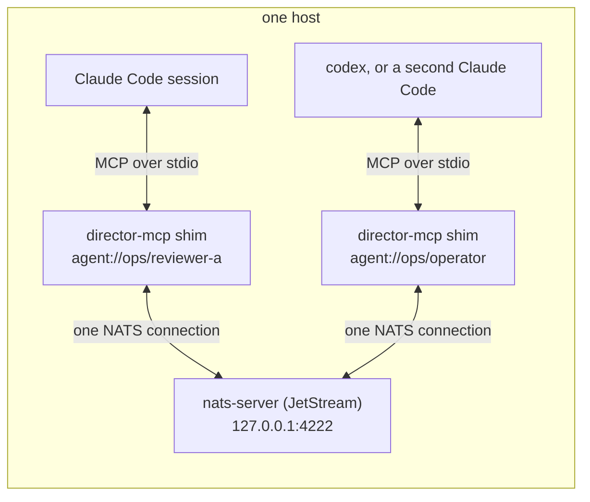

# Getting started: run the bus and join a session to it

This is the operator's path from nothing to two agent sessions exchanging
director envelopes over a local NATS broker, then on to authorization, the
global tier, and running the same thing under marvel. It documents what the
Phase 0 probe proved (`../probe/nats-phase-0/PROGRESS.md`); the
[shim reference](shim-reference.md) lists every variable, tool, address, and
field this page uses.

What you are standing up:



Each session gets its own shim process, launched by the harness as an MCP
stdio server. The shim holds one connection to the broker, a durable inbox
consumer, and a presence heartbeat. The harness sees eight tools, plus `cancel_held` and `mark_handled`, which appear only in presence-watch and handled modes.

## Prerequisites

Run `scripts/director-preflight` first. It names each tool below that it does not
find, finds too old, or cannot get a version from, with an install hint for your
system. It exits 1 when a required tool is missing, too old or unreadable, 2 when
it cannot read its manifest, and 0 otherwise (an absent optional tool is only a
note). It reads `scripts/director-preflight.tsv`, which is the list of record: the
tool, whether it is required, the minimum version, and which scripts need it.

Required:

- `python3` 3.11 or later (most of the scripts).
- `jq`, and `git`.
- `nats-server` 2.11 or later and the `nats` CLI (`brew install
  nats-server nats-io/nats-tools/nats`). The probe ran on 2.14.6.
- A harness that speaks MCP over stdio: Claude Code (interactive or `-p`),
  codex, or anything else with an MCP client.

Optional, each needed by only some scripts: `gh`, `claude`, `marvel`, `tmux`,
and `lsof`.

To install the shim from a published release you also need `curl`, `shasum` or
`sha256sum`, and `gh` (it checks where the download came from). Go 1.26 or later
is needed only to build the shim from source.

## 1. Start the broker

```sh
probe/nats-phase-0/start.sh &
```

The script derives the JetStream store from `DIRECTOR_PHASE0_HOME` (default
`~/.director/nats`), exports it, and execs `nats-server` on the checked-in
config: loopback only, port 4222, monitoring on 8222, anonymous. Run it
through the script; the config reads its store path from the environment as
an unquoted whole value, which is the one form nats-server substitutes, and
a bare `nats-server -c nats-server.conf` refuses to start with the variable
unset rather than writing to a stray path.

```sh
curl -s http://127.0.0.1:8222/varz | head -3     # it answers
```

The broker is reversible: kill the process and remove `~/.director/nats`.

### Keep it running across logins (macOS)

A broker started with `&` ends with its terminal and does not come back after
a reboot. To have launchd start it at login, give a user launch agent the
script, not `nats-server`: launchd starts the agent with no shell environment,
so a `ProgramArguments` copied from `ps` (which shows only what the script
`exec`s) fails on every start with `variable reference for
'DIRECTOR_PHASE0_STORE' ... can not be found`, and launchd restarts it every
`ThrottleInterval` seconds without ever reporting the job as failed.

Save as `~/Library/LaunchAgents/<your.label>.director-bus.plist`, with absolute
paths (launchd does not expand `~`):

```xml
<?xml version="1.0" encoding="UTF-8"?>
<!DOCTYPE plist PUBLIC "-//Apple//DTD PLIST 1.0//EN" "http://www.apple.com/DTDs/PropertyList-1.0.dtd">
<plist version="1.0">
<dict>
    <key>Label</key><string>your.label.director-bus</string>
    <key>ProgramArguments</key>
    <array>
        <string>/bin/bash</string>
        <string>/ABSOLUTE/PATH/TO/director/probe/nats-phase-0/start.sh</string>
    </array>
    <key>RunAtLoad</key><true/>
    <key>KeepAlive</key><dict><key>SuccessfulExit</key><false/></dict>
    <key>ThrottleInterval</key><integer>30</integer>
    <key>EnvironmentVariables</key>
    <dict>
        <key>HOME</key><string>/Users/YOU</string>
        <key>PATH</key><string>/opt/homebrew/bin:/usr/local/bin:/usr/bin:/bin</string>
    </dict>
    <key>StandardErrorPath</key><string>/Users/YOU/.director/launchd-logs/director-bus.err.log</string>
</dict>
</plist>
```

`PATH` must reach `nats-server` and `jq` (the script provisions the inbox
stream with them). Load it and check that it runs, not only that it loaded:

```sh
mkdir -p ~/.director/launchd-logs
launchctl bootstrap gui/$(id -u) ~/Library/LaunchAgents/your.label.director-bus.plist
launchctl print gui/$(id -u)/your.label.director-bus | grep -E 'state =|last exit'   # state = running
curl -s http://127.0.0.1:8222/varz | head -3
```

A job that reads `state = spawn scheduled` with a nonzero `last exit code` is
failing at start; its reason is in the error log.

## 2. Provision the streams and the presence bucket

A bare broker accepts a shim's connection and then strands it: the inbox
stream, the audit stream, and the presence bucket do not exist, and the shim
exits with `bucket not found`. Under `--strict-mcp-config` the harness
starts anyway, without its tools, and reports nothing wrong (finding-166).
So provision before the first shim connects:

```sh
nats stream add AGENT_INBOX --subjects 'agent.*.*.*.inbox,agent.*.*.role.*.inbox' \
  --storage file --retention limits --max-age 168h --max-msg-size 65536 --dupe-window 2m
nats stream add AGENT_AUDIT --subjects 'agent.audit' --storage file --retention limits --max-age 720h
nats kv add AGENT_STATE --ttl 90s --storage file
```

The `--max-age` on `AGENT_INBOX` is yours to set; 168h is only the example.
`director-mcp` reads the stream's own `max_age` when it starts, uses that for
how long it keeps its send records, and logs the value it read. If it cannot
read the stream, or the stream has no max age, it falls back to 168h and logs a
warning. It never changes the stream.

Verify:

```sh
nats stream ls          # AGENT_INBOX, AGENT_AUDIT
nats kv ls              # AGENT_STATE
```

A marvel-managed broker does this for you at start (see section 9).

A broker started with `probe/nats-phase-0/start.sh` also runs
`probe/nats-phase-0/provision.sh` once it answers (needs `jq`). It creates
`AGENT_INBOX` at 168h if it is missing and only ever raises an existing one:
a finite max age below 168h goes up to 168h, a longer one or an unlimited one
is left alone, and each shim durable (`mcp_*`) whose inactive threshold is
below the stream's max age is raised to a day above it. It prints each value
before and after. Run it by hand with `probe/nats-phase-0/provision.sh`; for the
authorized config set `DIRECTOR_PHASE0_ADMIN_USER` and
`DIRECTOR_PHASE0_ADMIN_PASS`.

## 3. Install the shim

Two ways, and neither starts a shim. Both put `director-mcp` at
`~/.director/bin/director-mcp` and keep the previous install, so
`director-install director-mcp --rollback` undoes either. Run `./install.sh --copy`
first if `~/.director/bin/director-install` is not there yet.

From a published release, with no Go toolchain:

```sh
~/.director/bin/director-install director-mcp --release <tag>
~/.director/bin/director-install --status
```

`<tag>` is a `director-mcp-alpha-<date>-<time>-<sha7>` tag from the repository's
releases page, or `latest-alpha`, which resolves once to the newest alpha tag and
records it. Each push to main that changes the shim publishes an alpha, so there
is no stable release yet and what an alpha contains is whatever merged last. The
installer downloads the binary for your host, `checksums.txt` and the attestation
bundle with `curl`, then checks in order: the binary's sha256 against
`checksums.txt`; the attestation with `gh attestation verify`, pinned to this
repository, its release workflow and a build from main; and a guarded `--version` run that must name
the commit. It stops at the first failure and leaves the installed shim alone. With
no `gh`, or a `gh` older than 2.49 (no attestation command), it stops and says so; build from source instead. `--status` shows the tag
and `origin verified`. Nothing upgrades on its own: install a newer tag to move.

From source, which needs Go:

```sh
~/.director/bin/director-install director-mcp --ref origin/main
```

or build it by hand:

```sh
cd cmd/director-mcp
go build -o director-mcp .
go test ./...                      # 25 broker-free tests
cd -
```

Check the preflight against the broker you just provisioned:

```sh
DIRECTOR_AGENT_ID=probe DIRECTOR_TEAM=ops DIRECTOR_WORKSPACE=aae-orc \
  cmd/director-mcp/director-mcp --preflight
# director-mcp preflight: ok
```

`--preflight` connects, verifies the streams and the bucket exist, and
exits. It creates no consumer and writes no presence. A launcher runs it
before starting a harness so a broken bus fails the spawn instead of
producing a session that looks healthy and cannot be reached (R-93).

## 4. Join a Claude Code session

The shim is launched by the harness, with the session's identity in its
environment. Three values are the identity, and each must match
`[A-Za-z0-9_-]` or the shim refuses to start:

| Variable | Meaning |
|---|---|
| `DIRECTOR_AGENT_ID` | this session's id; the `id` in `agent://team/id` |
| `DIRECTOR_TEAM` | the team (default `default`) |
| `DIRECTOR_WORKSPACE` | the workspace (default `default`) |

`NATS_URL` names the broker (default `nats://127.0.0.1:4222`).

**Starting one session by hand.** On a host with no role library, the first-run
path is a per-host seat file and `scripts/director start`; "Start the director"
in the README has the file's keys, the restart form and the recovery steps. The
launcher for seats cast from a role library is `sim/twin/cast-launch.sh`, and it
needs that library. The two forms below pass the same server by hand, so you can
see what a launcher wires.

**Per invocation, the recommended form.** Pass the server on the command
line so the id belongs to exactly this process:

```sh
SHIM="$PWD/cmd/director-mcp/director-mcp"
claude --strict-mcp-config --mcp-config "$(printf '{"mcpServers":{"director":{"command":"%s","env":{"DIRECTOR_AGENT_ID":"%s","DIRECTOR_TEAM":"ops","DIRECTOR_WORKSPACE":"aae-orc","NATS_URL":"nats://127.0.0.1:4222"}}}}' "$SHIM" reviewer-a)"
```

`--strict-mcp-config` keeps any project-scoped director entry with a baked
id from loading beside this one, which is how several sessions in one
project ended up sharing one address in the identity incident of
2026-09-12.

**Registered in the project, the persistent form.** `claude mcp add`
writes the server into Claude Code's local-scope config for this project:

```sh
claude mcp add --scope local director-mcp \
  -e DIRECTOR_AGENT_ID=operator -e DIRECTOR_TEAM=ops -e DIRECTOR_WORKSPACE=aae-orc \
  -e NATS_URL=nats://127.0.0.1:4222 \
  -- "$PWD/cmd/director-mcp/director-mcp"
claude mcp list                    # director-mcp ... Connected
```

Two things to know about this form. Tools load at session start, so the
session that ran `claude mcp add` does not have them; a fresh session in
this project does. And every session in this project now launches a shim
with the same id, so use it for one standing seat (the human's own) and
never for a fleet. Remove it with `claude mcp remove director-mcp --scope
local`.

**A dialog can block a fresh seat.** A new Claude Code session may show a
"Teach auto mode about your environment?" menu under the prompt, with "1. Yes"
preselected. While it is up, text injected into the pane does not reach the
model, and the seat still looks healthy to marvel. Pressing
Enter picks Yes and opens the setup wizard. Capture the pane before you inject;
if the menu is showing, move to "2. Not now" with the arrow keys, press Enter,
and capture again to confirm it is gone. Escape is the fallback. Do not choose
"Yes" or "Don't show again". This was found on the third cluster's bring-up
(friction S12-9).

Both forms produce the same result: `claude mcp list` reports the server
connected, and the shim's presence record appears in the bucket:

```sh
nats kv ls AGENT_STATE                                   # presence.ops.operator.<instance>
nats kv get AGENT_STATE 'presence.ops.operator.<instance>' --raw
```

**A seat that takes mail needs the channel cue.** A Claude Code seat that has
set nothing reads mail only when it calls `wait_for_message` or
`inbox_summary`, so a seat sitting idle is never woken when mail arrives. With
the channel cue on, the shim sends that seat's Claude Code a notice when mail
arrives. Arrivals within a few seconds of each other fold into one notice,
which carries a count and the sender, performative and message id of the
oldest waiting message (never the body). No notice is sent while the seat has
a `wait_for_message` open, since that call delivers the message; a notice
nobody answers is sent again after five minutes, after twenty, after forty, and
then hourly until 24 hours after the first, when one INFORM goes to director and
the cue stops for those messages. The notice starts a turn, and
the model then drains with `wait_for_message` as before, so order and acks do
not change. Two settings turn it on, both per seat:

- `DIRECTOR_CUE=1` in the shim's `env`. Only the exact value `1` counts.
- `--dangerously-load-development-channels server:director` on the `claude`
  command line, where `director` is the name the server is registered under.

The per-invocation form above, with both added:

```sh
claude --strict-mcp-config --dangerously-load-development-channels server:director \
  --mcp-config "$(printf '{"mcpServers":{"director":{"command":"%s","env":{"DIRECTOR_AGENT_ID":"%s","DIRECTOR_TEAM":"ops","DIRECTOR_WORKSPACE":"aae-orc","NATS_URL":"nats://127.0.0.1:4222","DIRECTOR_CUE":"1"}}}}' "$SHIM" reviewer-a)"
```

The flag brings a one-time startup prompt, "WARNING: Loading development
channels", with "1. I am using this for local development" and "2. Exit". It
needs a person to answer it, and a seat nobody attends stays at that prompt
until someone does, so start a seat with the cue where its first screen will
be read. After the prompt, the shim sends a self-test notice and reports the
cue as `live` once the model answers it, or `unverified` if it does not.
The cue is enabled only for the client protocol version it was measured on
(2025-11-25). Under any other version the shim turns the cue off and reports
`protocol <v> not verified`, so a Claude Code release that changes its
protocol version leaves a seat with both settings never woken. Leave both
settings off and the shim is unchanged: the seat reads mail when it
polls, and only then.

## 5. Join a second harness

A codex session joins by pointing its MCP client at the same binary, per
invocation, without editing the user's config:

```sh
codex exec \
  -c 'mcp_servers.director.command="'"$SHIM"'"' \
  -c 'mcp_servers.director.env.DIRECTOR_AGENT_ID="codex-a"' \
  -c 'mcp_servers.director.env.DIRECTOR_TEAM="ops"' \
  -c 'mcp_servers.director.env.DIRECTOR_WORKSPACE="aae-orc"' \
  -c 'mcp_servers.director.env.NATS_URL="nats://127.0.0.1:4222"' \
  --skip-git-repo-check --dangerously-bypass-approvals-and-sandbox \
  -C "$PWD" "call set_presence with state busy, then list_roster" < /dev/null
```

Three flags earned the hard way: `--skip-git-repo-check` for a non-git
working directory; the approvals bypass, because codex otherwise refuses the
MCP tool call with "requires approval, but approval policy is never"; and
stdin from `/dev/null`, because `codex exec` blocks reading a piped stdin.

A headless Claude Code run joins the same way, with an allowlist so the
non-interactive run can call the tools without a permission prompt:

```sh
claude -p --mcp-config "$(printf '{"mcpServers":{"director":{"command":"%s","env":{"DIRECTOR_AGENT_ID":"cc-planner","DIRECTOR_TEAM":"ops","DIRECTOR_WORKSPACE":"aae-orc","NATS_URL":"nats://127.0.0.1:4222"}}}}' "$SHIM")" \
  --allowedTools "mcp__director__set_presence,mcp__director__wait_for_message,mcp__director__send_message,mcp__director__list_roster" \
  --output-format text "list the roster and report who is present"
```

The worked script is `probe/nats-phase-0/cross-harness-demo.sh`.

## 6. Send and receive

From inside a session the eight tools are `send_message`, `wait_for_message`,
`inbox_summary`, `list_roster`, `set_presence`, `broadcast`, `report_status`, and `audit_lookup`;
`cancel_held` and `mark_handled` appear only in presence-watch and handled modes. A first exchange, as the
model calls them:

```
list_roster
  -> present: [ {agent_id: operator, team: ops, workspace: aae-orc, state: idle, ...},
                {agent_id: reviewer-a, ...} ]

send_message  to: agent://ops/operator  performative: REQUEST
              text: "please review PR #12"  refs: ["pr:12"]
  -> status: accepted for delivery, message_id: 01M2..., tier: local
     note: accepted is not delivered or read; the recipient reports those (R-08)
```

On operator's side nothing happens until the model polls:

```
wait_for_message  timeout_seconds: 60
  -> message: { performative: REQUEST, sender: {agent_id: reviewer-a, ...},
                content: {type: text, data: "please review PR #12", refs: ["pr:12"]},
                message_id: 01M2..., conversation_id: cid-01M2... }
     tier: local

send_message  to: agent://ops/reviewer-a  performative: AGREE
              in_reply_to: 01M2...  text: "on it; reply_by 17:00"
```

With a backlog, look before reading, then drain in one call, oldest first:

```
inbox_summary
  -> summary: {total: 31, by_sender: {...}, by_performative: {INFORM: 28, REQUEST: 3},
               flagged: [ {sequence: 433, performative: REQUEST, reasons: [...], ...} ],
               sequences: {local: [431, 432, 433, ...]}}
     note: nothing was acked; drain in order with wait_for_message max=N

wait_for_message  max: 50
  -> messages: [ {message: {...}, tier: local, sequence: 431}, ... ], count: 31
```

The sequence, with the two facts that shape every director design decision:

```mermaid
sequenceDiagram
  participant A as reviewer-a
  participant Bus as AGENT_INBOX (durable)
  participant M as operator

  A->>Bus: send_message REQUEST
  Bus-->>A: accepted for delivery + message_id
  Note over Bus: stored; operator may be offline, or busy, or asleep
  M->>Bus: wait_for_message (the poll)
  Bus-->>M: the REQUEST
  M->>Bus: send_message AGREE, in_reply_to
  Bus-->>M: accepted
  A->>Bus: wait_for_message
  Bus-->>A: the AGREE
```

**Receive is a poll.** MCP is request and response, so a shim cannot push a
message into a running model's context. The message waits in the durable
inbox until the model calls `wait_for_message`. The transport floor is
about 20 ms; the latency you feel is the time until the next poll.

**Accepted is not delivered.** The send call acknowledges that the broker
stored the bytes. Only the receiver, after processing, can say the message
arrived (R-08); reply with `in_reply_to` set so the sender can correlate.

**Store and forward.** A message sent to a session that is not connected
waits in the stream (72 hours) and replays when that session first pulls.
In the probe, the sender exited before the receiver ever connected, and the
receiver's first poll returned the message.

## 7. Watch from outside

The bus is inspectable without a client of your own:

```sh
nats kv ls AGENT_STATE                            # who is present
nats stream view AGENT_AUDIT                      # every envelope, append-only, 30 days
nats stream info AGENT_INBOX                      # messages waiting
nats sub 'agent.aae-orc.ops.>'                    # live traffic for one team
nats consumer ls AGENT_INBOX                      # one durable per shim instance
```

Presence keys are `presence.<team>.<id>.<instance>` and expire 90 seconds
after the last beat. The shim renews every 30 seconds on its own timer, so a
live session stays present through a long model turn without calling any
tool (R-56).

## 8. Turn on authorization

The anonymous broker means every local process holds publish and subscribe
on every subject, so a name on the bus is a claim nothing checks. The
authorization block binds a credential to the subjects it may use (R-77,
R-82):

```sh
export DIRECTOR_ADMIN_PASS="$(openssl rand -hex 24)"
export DIRECTOR_OPS_PASS="$(openssl rand -hex 24)"
export DIRECTOR_PHASE0_HOME="${DIRECTOR_PHASE0_HOME:-$HOME/.director/nats}"
export DIRECTOR_PHASE0_STORE="$DIRECTOR_PHASE0_HOME/store"
nats-server -c probe/nats-phase-0/nats-server-auth.conf &
```

`nats-server-auth.conf` is the base config plus `authorization.conf`. The
passwords are environment-interpolated so no secret is committed; an unset
variable makes the server refuse to start. It is a separate activation
config on purpose: a routine `start.sh` never silently requires auth and
drops a live fleet. Relaunching the broker with auth on is a coordinated
change; every connected shim must carry a credential.

The shim reads its credential from the environment:

| Variable | Meaning |
|---|---|
| `DIRECTOR_NATS_USER`, `DIRECTOR_NATS_PASS` | a broker user and password |
| `DIRECTOR_NATS_CREDS` | a `.creds` file (NKey or JWT), the forward path |

Two users ship in the block: `director_admin` (provisioning and break-glass,
never handed to a session) and `ops`, confined to `agent.aae-orc.ops.>`, the
audit stream, its own presence keys, and the JetStream plumbing the shim
needs. It cannot publish or subscribe in another team's subtree. To add a
team, copy the `ops` user, substitute the team name, and give it its own
password variable. `probe/nats-phase-0/verify-auth.sh` proves the block on a
throwaway broker on port 4223 without touching the live one, 7 of 7.

Two residuals are known and owned elsewhere: one credential per team rather
than per session (per-session minting is marvel's, R-85), and JetStream's
account-scoped API, which real per-team isolation closes with per-team
streams or accounts (the two-tier design, R-86).

## 9. Run it under marvel

Everything above is what marvel does for you when a cluster declares a
managed bus. In `~/.marvel/config.yaml`:

```yaml
clusters:
  - name: kinu
    socket: ~/.marvel/run/marvel.sock
    bus:
      managed: true
      listen: 127.0.0.1:4222
```

The daemon renders the broker config and a 0600 authorization file with one
user per applied team, starts `nats-server` as its own child, provisions
the three objects above, and stamps `NATS_URL`, `DIRECTOR_NATS_USER`,
`DIRECTOR_NATS_PASS`, and `DIRECTOR_AGENT_ID` into every session's
environment. No session spawns while the bus is down or bare
(`bus.unavailable` on marvel's event ring), which is R-93 at the control
plane. A launcher then only has to wire the shim into the harness; the
twin's `sim/twin/cast-launch.sh` is the launcher for seats cast from a role
library, and `sim/twin/` carries the manifest and the check runbook. marvel's own documentation of
the bus section lives in its repository, in the admin guide, under "The message
bus".

## 10. Join the global tier

One local broker per host reaches the director on another host through a
leaf link to a global hub. Nothing in a worker's shim changes; a supervisor's
shim gains three variables:

```sh
DIRECTOR_GLOBAL_DOMAIN=global DIRECTOR_CLUSTER=mokuzai DIRECTOR_GLOBAL_ROLE=supervisor \
  director-mcp
```

The shim keeps its one connection to the local broker and reaches the hub's
JetStream domain over the broker's leaf link; the session holds no hub
credential. `global://director` and `global://<cluster>/supervisor` become
send addresses, `wait_for_message` polls both tiers and names the one it
found, and `list_roster` gains a tier column. The broker-side change is a
JetStream domain plus one `leafnodes.remotes` entry with an NKey seed the hub
operator hands you privately; `probe/nats-global-tier/recipe-mokuzai.md`
walks it host by host, and `probe/nats-global-tier/verify-global-shim.sh`
proves the path against the running hub with a throwaway leaf, 14 of 14.

Every host on the global tier must stay awake while it carries seats. A host
that idle-sleeps drops its leaf link and its sessions, and the other tier sees
silence, not an error. marvel's admin guide (`docs/admin-guide.md`, "Host
prerequisites", in its repository) gives the ways to keep a host awake.

## Cleanup and cautions

- Remove a project-registered shim with `claude mcp remove director-mcp
  --scope local`.
- **Do not `pkill -f director-mcp`.** The shim serving your own session is a
  `director-mcp` process too, so the broad match kills your own bus tools.
  Scope cleanup by environment (`pkill -f 'DIRECTOR_AGENT_ID=codex-a'`) or
  by pid.
- Assign a distinct id per session at the launcher. Two shims with one id
  each get their own copy of every message (a per-instance durable makes
  the collision loud rather than lossy), the roster shows two rows, and the
  second shim logs a warning naming the first. The fix is distinct ids, not
  tolerating the duplication.

## Troubleshooting

| Symptom | Cause | Fix |
|---|---|---|
| shim exits with `presence KV AGENT_STATE: nats: bucket not found` | broker not provisioned | section 2, or run `--preflight` before the harness |
| `claude mcp list` shows the server but the tools are absent | tools load at session start | start a new session |
| the roster is empty while a session runs | a shim build older than 2026-09-12 set presence once and never renewed | rebuild the shim; presence is on a 30s timer now |
| a message never arrives | the receiver has not polled | it arrives on the receiver's next `wait_for_message`; there is no push |
| did my message arrive | `send_message` says only "accepted" | `director-mcp asks --id <message_id>` reports `delivery`: `read`, `not_yet_read`, `expired_unread`, `no_reader` or `unknown`. `delivery` is the receiver's ack, not a reply; in handled mode (`DIRECTOR_HANDLED=1`) a seat acks only at `mark_handled`, so mail it received and has not marked handled is not yet acked |
| `send_message` refused: no live presence for the recipient | R-92: the workspace is resolved from live presence | pass `workspace` explicitly to address a known mailbox verbatim |
| `send_message` refused: no consumer filters the subject | a send with `workspace` set names a subject no durable consumer filters with that exact filter, often a typo in the workspace, team or id | fix the address; to leave mail for a seat that has not started, send with `cold: true` |
| shim refuses to start naming the id | the id has a byte outside `[A-Za-z0-9_-]` | fix the launcher; the shim rejects and never rewrites |
| a second shim logs `WARNING: ... instance ... pid ...` | two sessions share one id | give each session its own id |
| authorization violation in the shim log | the broker requires a credential | set `DIRECTOR_NATS_USER` and `DIRECTOR_NATS_PASS` for the team |
